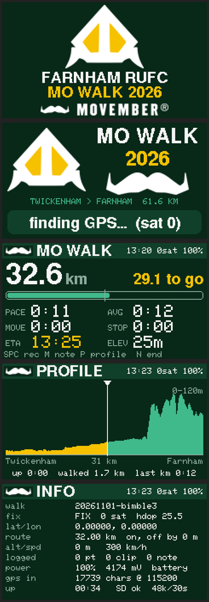

# Mo'Walk

An iPhone app for long walks: it records the walk on the phone's GPS, files your **photos, interviews and notes** under it with where you were, and can **guide you along a route** with a compass arrow and spoken turn directions.

It was built for the Farnham RUFC Movember walk, 60 km overnight from Twickenham to Farnham, on 20 November 2026. That route is built in, but you can follow any GPX file.

<p align="center"></p>

<p align="center"><em>The app started life as a companion to a little pocket GPS tracker (above). That hardware isn't needed: this version runs on the phone alone.</em></p>

## What it does

- **Records your walk.** Distance, time out, time moving and stopped, and speed in km/h (now and average). It keeps recording with the phone locked in your pocket.
- **Photos, interviews and notes.**
  - **Interviews:** record people as you go, with their name and a consent tick.
  - Everything is tagged with where you were and how far into the walk.
- **Walks list.** Every walk you record is listed. Tap one to see:
  - a map of the route you took, with a pin for every photo, interview and note;
  - its stats and everything you captured;
  - **Share GPX** (the track plus pins) or **Share walk (zip)**, for WhatsApp, Strava, OS Maps or Komoot.
- **Follow a route.** Tap the compass button (top right).
  - **Picking a route:** choose the Mo Walk, or load any `.gpx` from Files. You can also share a GPX to Mo'Walk from WhatsApp, Mail or AirDrop.
  - **The arrow:** a big arrow points down the path. It uses the phone's compass, or your walking direction if the compass is weak.
  - **Turns:** the next turn shows on screen, e.g. *"80 m · Turn left, then bear right"*.
  - **Spoken directions:** they work with the phone locked. For example: *"In 50 metres, turn left"*, *"Off route. The path is 60 metres away"*, *"Back on route"*.

---

## Installing it on your iPhone (from a Mac)

The app isn't in the App Store. You build it on your Mac and put it straight on your phone. A script does the hard work: it checks everything, tells you exactly what to do at each step, and asks simple **y/n** questions.

> **Already got a TestFlight invite from Warwick?** Then ignore all of this: open the invite on your iPhone, install from TestFlight, done.

### What you need

| | |
|---|---|
| A **Mac** | macOS 13.5 or newer. About **40 GB free** disk space if Xcode isn't installed yet |
| An **iPhone** | iOS 17 or newer, and its passcode |
| A **cable** | iPhone to Mac. The one that came with the phone is ideal; some cheap cables only charge |
| Your **Apple ID** | Email and password. A normal free Apple ID is fine |
| Your **Mac password** | The one you log in with. Terminal may ask for it |
| **Time** | About 15 minutes, plus 30–60 minutes for the Xcode download if you haven't got it |

You **don't** need to know anything about programming.

### Step 1: Open Terminal

1. Press **⌘ Command + Space** (opens Spotlight search).
2. Type **Terminal** and press **Enter**.
3. A window with text opens. That's Terminal. Leave it open.

### Step 2: Download Mo'Walk and start the installer

Copy this **whole line** (triple-click it to select it all, then **⌘ C**):

```bash
cd ~/Downloads && curl -L -o MoWalk.zip https://github.com/warwickwoodfall/MoWalk/archive/refs/heads/main.zip && unzip -oq MoWalk.zip && cd MoWalk-main && bash install.sh
```

Click in the Terminal window, paste it (**⌘ V**) and press **Enter**.

That downloads the app into your **Downloads** folder (as `MoWalk-main`) and starts the installer.

### Step 3: Follow the installer

It works through these steps, **checking each one** and stopping to tell you what to do if something needs your help. Answer **y** or **n** and press **Enter** when it asks.

1. **Checks your Mac**: macOS version and disk space.
2. **Xcode**: Apple's free app for building iPhone apps.
   - If it's missing, the App Store opens on the Xcode page. Click **Get**, wait for it to install, **open Xcode once**, tick **iOS** if it asks, then come back and press **Enter**.
   - It may ask for your **Mac password** to finish setting Xcode up. Nothing shows as you type; that's normal.
3. **Your Apple ID in Xcode**: if Xcode isn't signed in, it tells you how. Click **Xcode** in the menu bar, then **Settings…**, then **Accounts**, then **+**, then **Apple ID**, and sign in. You'll see your name with **(Personal Team)**.
4. **Your iPhone**: this is when you **plug the phone in**, not before.
   - **Unlock** it.
   - If it asks **"Trust This Computer?"**, tap **Trust** and enter your passcode.
   - If **Developer Mode** is off, it tells you how to turn it on: on the iPhone, **Settings → Privacy & Security → Developer Mode** (at the very bottom) → **On** → **Restart** → **Turn On** → enter your passcode.
5. **Builds the app**: 1–5 minutes.
   - If a box pops up saying **"codesign wants to access key…"**, type your **Mac password** and click **Always Allow**. It may ask two or three times.
6. **Installs it** on the phone. Keep the phone **unlocked** until this finishes.
7. **Lets it open (first time only)**. The phone has to trust your Apple ID as an app maker:
   - Go to **Settings → General → VPN & Device Management**.
   - Under **Developer App**, tap your Apple ID.
   - Tap **Trust**, then **Trust** again.

When it says **All done**, unplug the phone and open **Mo'Walk**.

### Step 4: First time you open the app

The iPhone asks for permissions. Say yes:

- **Location**: **Allow While Using App**. It records your walk and tags your photos.
- **Camera**, **Microphone** (for interviews) and **Photos** (saves a copy of walk photos): **Allow**.

### ⚠️ With a free Apple ID the app stops opening after 7 days

That's Apple's rule for apps you install yourself. To renew it:

1. Plug the phone in and unlock it.
2. Open Terminal and paste:
   ```bash
   cd ~/Downloads/MoWalk-main && bash install.sh
   ```
3. Answer **y** a few times. It remembers everything from last time. Your walks and photos are kept.

(A paid Apple Developer account, £79 a year, makes it last a year instead.)

### If something goes wrong

| What you see | What to do |
|---|---|
| "I can't see an iPhone plugged in" | Try another cable or another USB port. Unlock the phone. Tap **Trust** on it. |
| "Developer Mode" isn't in Settings | Keep the phone plugged in and unlocked with **Xcode open** for a minute, then look again. |
| "Apple won't give out the app id" | Answer **y**: it picks a new one and carries on. |
| "maximum number of apps" | A free Apple ID can only self-install 3 apps on a phone. Delete one you've installed this way (press and hold the icon → **Remove App**). |
| The app icon is greyed out or won't open after a week | That's the 7-day rule. Re-run the installer (above). |
| Anything else | The installer saves everything it did to `build.log` in the `MoWalk-main` folder. Send that to Warwick. |

---

## For developers

- SwiftUI, iOS 17, no third-party code.
- `MoWalk.xcodeproj` is generated from `project.yml` with [XcodeGen](https://github.com/yonaskolb/XcodeGen) and committed, so you can just open it in Xcode.
- To build, pick your own team and bundle id in Signing & Capabilities. The installer passes them on the command line: `DEVELOPMENT_TEAM=… PRODUCT_BUNDLE_IDENTIFIER=…`.

| File | What it does |
|---|---|
| `CaptureStore.swift` | Walks: phone GPS track, 10 m breadcrumb odometer, jump filter. Captures. GPX/zip export |
| `Route.swift` | GPX parsing, snapping your position to the route, turn detection |
| `Navigator.swift` | Wayfinding: aim point 60 m ahead, turn and off-route cues, voice and haptics |
| `ContentView.swift`, `WalkViews.swift`, `FollowViews.swift` | Screens |
| `Media.swift` | Camera, interview recorder, playback |
